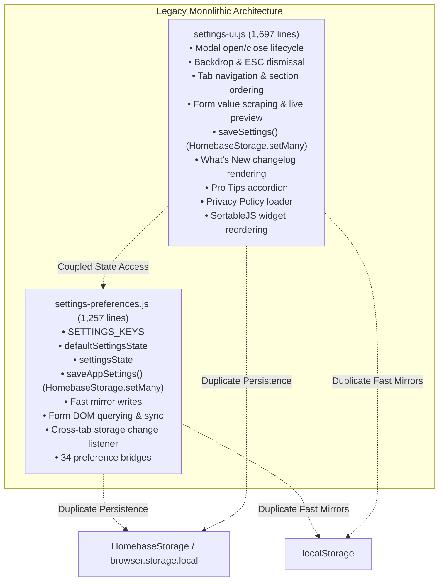
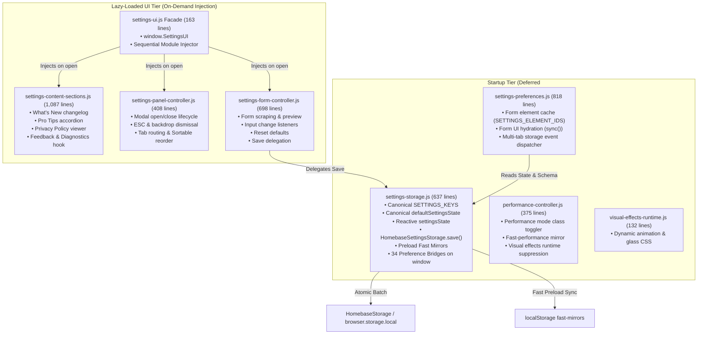

# Cycle #14 Final Architecture Summary: Settings Subsystem Modularization

**Cycle**: #14 — Settings Subsystem Decomposition & Modularization  
**Status**: Completed & Stabilized  
**Date**: 2026-10-11  

---

## 1. Executive Summary

Cycle #14 accomplished the architectural restructuring of Homebase's settings subsystem, resolving legacy technical debt that had accumulated in two large monolithic controllers: [`src/newtab/settings/settings-preferences.js`](file:///c:/Users/Administrator/Desktop/Homebase/src/newtab/settings/settings-preferences.js) (originally 1,257 lines) and [`src/newtab/settings/settings-ui.js`](file:///c:/Users/Administrator/Desktop/Homebase/src/newtab/settings/settings-ui.js) (originally 1,697 lines).

Across four methodical phases (Phase 1 Audit, Phase 2 Storage Extraction, Phase 3 UI Decomposition, and Phase 4 Stabilization):
- **Core Storage Engine Isolated**: Created [`src/newtab/settings/settings-storage.js`](file:///c:/Users/Administrator/Desktop/Homebase/src/newtab/settings/settings-storage.js), establishing a single canonical authority for `SETTINGS_KEYS`, `defaultSettingsState`, in-memory reactive `settingsState`, atomic batch persistence, mirror synchronizations, and 34 global preference bridges.
- **Settings UI Decomposed**: Stripped 1,534 lines out of `settings-ui.js` (-90.4% reduction down to 163 lines), delegating dedicated responsibilities to [`settings-content-sections.js`](file:///c:/Users/Administrator/Desktop/Homebase/src/newtab/settings/settings-content-sections.js), [`settings-panel-controller.js`](file:///c:/Users/Administrator/Desktop/Homebase/src/newtab/settings/settings-panel-controller.js), and [`settings-form-controller.js`](file:///c:/Users/Administrator/Desktop/Homebase/src/newtab/settings/settings-form-controller.js).
- **Persistence Unified**: Eliminated duplicated `HomebaseStorage.setMany()` batches and ad-hoc `localStorage.setItem` writes from the UI layer, routing all settings mutations exclusively through `HomebaseSettingsStorage.save()`.
- **Startup Performance Preserved**: Maintained strict zero-overhead new-tab loading by keeping all settings UI components lazy-loaded on demand while startup scripts load only the lightweight storage engine and runtime listeners.
- **Test Invariants Expanded**: Increased test coverage by 17 unit tests across 3 new test suites (1,203 test lines), keeping repository test passage at 100% (387/387 unit tests + headless browser smoke test).

---

## 2. Before & After Architecture Diagrams

### 2.1 Before Cycle #14 (Monolithic & Split Ownership)



### 2.2 After Cycle #14 (Decoupled, Modular Architecture)



---

## 3. Module Ownership Map

The complete `src/newtab/settings/` subsystem consists of 15 files with strictly defined responsibilities:

| File | Lines | Loading Tier | Canonical Responsibility | Public API / Namespace |
|---|---|---|---|---|
| [`settings-storage.js`](file:///c:/Users/Administrator/Desktop/Homebase/src/newtab/settings/settings-storage.js) | 637 | Deferred `<script>` | Authoritative schema, defaults, reactive state, batch persistence, mirror synchronization, and 34 preference bridges. | `window.HomebaseSettingsStorage` |
| [`settings-preferences.js`](file:///c:/Users/Administrator/Desktop/Homebase/src/newtab/settings/settings-preferences.js) | 818 | Deferred `<script>` | DOM element resolution, live form hydration, and cross-tab WebExtension storage event listeners. | `window.HomebaseSettingsPreferences` |
| [`settings-ui.js`](file:///c:/Users/Administrator/Desktop/Homebase/src/newtab/settings/settings-ui.js) | 163 | Lazy Loaded | Lightweight orchestrator facade; dynamically loads content sections, panel controller, and form controller. | `window.SettingsUI`, `window.openSettings` |
| [`settings-content-sections.js`](file:///c:/Users/Administrator/Desktop/Homebase/src/newtab/settings/settings-content-sections.js) | 1,087 | Lazy Loaded | What's New release notes and badges, Pro Tips accordion and filters, Privacy Policy markdown fetcher, feedback actions, and diagnostic button integration. | `window.HomebaseSettingsContentSections` |
| [`settings-panel-controller.js`](file:///c:/Users/Administrator/Desktop/Homebase/src/newtab/settings/settings-panel-controller.js) | 408 | Lazy Loaded | Settings dialog lifecycle (open/close animations), backdrop and ESC handling, focus management, tab navigation, section DOM order enforcement, and widget Sortable reordering. | `window.HomebaseSettingsPanelController` |
| [`settings-form-controller.js`](file:///c:/Users/Administrator/Desktop/Homebase/src/newtab/settings/settings-form-controller.js) | 698 | Lazy Loaded | Form state scraping, live slider preview binding, change listeners, tips toggle sync, restore defaults, and save delegation. | `window.HomebaseSettingsFormController` |
| [`sub-settings-ui.js`](file:///c:/Users/Administrator/Desktop/Homebase/src/newtab/settings/sub-settings-ui.js) | 139 | Deferred `<script>` | DOM utilities for collapsible sub-settings accordions and color trigger contrast rings. | `setSubSettingsExpanded`, `updateColorTrigger` |
| [`material-color-picker.js`](file:///c:/Users/Administrator/Desktop/Homebase/src/newtab/settings/material-color-picker.js) | 726 | Deferred `<script>` | Material Design color picker popup and custom color palette manager for bookmark tiles. | `setupMaterialColorPickers` |
| [`search-engine-settings.js`](file:///c:/Users/Administrator/Desktop/Homebase/src/newtab/settings/search-engine-settings.js) | 414 | Deferred `<script>` | Modal for managing, reordering, adding, and deleting custom search engines. | `setupSearchEnginesModal` |
| [`performance-controller.js`](file:///c:/Users/Administrator/Desktop/Homebase/src/newtab/settings/performance-controller.js) | 375 | Deferred `<script>` | Performance mode toggle, fast mirror sync, DOM class management, and visual effects disabling. | `window.HomebasePerformanceController` |
| [`visual-effects-runtime.js`](file:///c:/Users/Administrator/Desktop/Homebase/src/newtab/settings/visual-effects-runtime.js) | 132 | Deferred `<script>` | Dynamic runtime CSS injection for bookmark grid animations and glass styles. | `applyGridAnimation`, `applyGlassStyle` |
| [`cinema-mode-runtime.js`](file:///c:/Users/Administrator/Desktop/Homebase/src/newtab/settings/cinema-mode-runtime.js) | 71 | Deferred `<script>` | Distraction-free dashboard cinema mode toggle and shortcut listeners. | `setupCinemaMode` |
| [`visual-effects-settings.js`](file:///c:/Users/Administrator/Desktop/Homebase/src/newtab/settings/visual-effects-settings.js) | 200 | Deferred `<script>` | Sub-modals for grid animation and glass selection with real-time hover previews. | `setupAnimationSettings`, `setupGlassSettings` |
| [`backup-import.js`](file:///c:/Users/Administrator/Desktop/Homebase/src/newtab/settings/backup-import.js) | 631 | Deferred `<script>` | Transactional state backup, import schema validation, delta computation, and rollback safety. | `window.HomebaseBackup` |
| [`diagnostic-ui.js`](file:///c:/Users/Administrator/Desktop/Homebase/src/newtab/settings/diagnostic-ui.js) | 1,110 | Lazy Loaded | Developer debug telemetry, storage quota monitor, health classification, and automated repair. | `window.HomebaseDiagnosticUI` |

---

## 4. Key Flows & Sequences

### 4.1 Persistence Flow
When the user clicks "Save Changes" or modifies an auto-save preference:

```text
[User Action: Save Settings]
        │
        ▼
HomebaseSettingsFormController.handleSaveSettings()
        │  Scrapes inputs via scrapeFormValues()
        │  Computes update delta object
        ▼
HomebaseSettingsStorage.save(updates)
        │
        ├── 1. Mutates in-memory settingsState
        ├── 2. Writes fast mirrors (fast-bg-dim, fast-show-sidebar, fast-time-format)
        ├── 3. Emits atomic HomebaseStorage.setMany(storageBatch)
        │      └── Fallback: browser.storage.local.set()
        └── 4. Returns updated settingsState
        │
        ▼
HomebaseSettingsPreferences.sync(updatedState)
        │  Synchronizes UI checkboxes, inputs, and previews
        ▼
HomebaseSettingsPanelController.closeSettingsModal()
```

### 4.2 Lazy-Loading Sequence
When the user interacts with the settings button:

```text
[User Clicks Settings Button / openSettings()]
        │
        ▼
window.SettingsUI.open(options)
        │
        ▼
ensureSettingsModulesLoaded()
        │
        ├── Step 1: Injects newtab/settings/settings-content-sections.js
        │           └── Defines window.HomebaseSettingsContentSections
        │
        ├── Step 2: Injects newtab/settings/settings-panel-controller.js
        │           └── Defines window.HomebaseSettingsPanelController
        │
        └── Step 3: Injects newtab/settings/settings-form-controller.js
                    └── Defines window.HomebaseSettingsFormController
        │
        ▼
HomebaseSettingsPanelController.openSettingsModal(options)
        │  Enforces DOM order, selects tab, focuses initial element
        ▼
HomebaseSettingsFormController.setupFormListeners() (idempotent init)
HomebaseSettingsContentSections.setupWhatsNew() (idempotent init)
```

---

## 5. Backward Compatibility & Public API Guarantees

All public surfaces across the application remain 100% backward-compatible:
1. **`window.SettingsUI`**: Preserves `.init()`, `.open()`, and `.ensureFeedbackDiagnosticButton()`.
2. **Global Function Aliases**: `window.openSettings` and `window.setupSettingsUI` invoke `SettingsUI` seamlessly.
3. **Preference Bridges**: All 34 preference accessors on `window` (e.g. `appTimeFormatPreference`, `appBackgroundDimPreference`, `appPerformanceModePreference`) read and write to `settingsState`.
4. **HTML Selectors & IDs**: Zero DOM ID renames or structure mutations; existing CSS and Sortable containers operate identically.

---

## 6. Testing Coverage & Quality Assurance

Cycle #14 expanded automated unit test coverage across the settings subsystem:

| Test File | Lines | Unit Tests | Verification Focus |
|---|---|---|---|
| [`tests/unit/settings-storage.test.mjs`](file:///c:/Users/Administrator/Desktop/Homebase/tests/unit/settings-storage.test.mjs) | 90 | 3 | Storage initialization, atomic batch save, preference bridge sync |
| [`tests/unit/settings-content-sections.test.mjs`](file:///c:/Users/Administrator/Desktop/Homebase/tests/unit/settings-content-sections.test.mjs) | 380 | 7 | Changelog markdown rendering, pro tips accordion/filter, privacy policy, diagnostics button hook |
| [`tests/unit/settings-panel-controller.test.mjs`](file:///c:/Users/Administrator/Desktop/Homebase/tests/unit/settings-panel-controller.test.mjs) | 471 | 5 | Modal open/close lifecycle, ESC/backdrop dismissal, tab routing, section ordering, Sortable reorder |
| [`tests/unit/settings-form-controller.test.mjs`](file:///c:/Users/Administrator/Desktop/Homebase/tests/unit/settings-form-controller.test.mjs) | 352 | 5 | Form scraping, live previews, save delegation, reset defaults, fallback handling |
| **Cycle #14 Additions** | **1,293** | **20** | **Total new tests introduced in Cycle #14** |

### Complete Verification Results
- **`node --check`**: Clean syntax across all modified, new, and test JavaScript files.
- **`scripts/check-newtab-static.mjs`**: PASS (48 key extracted module paths verified, 66 deferred scripts, 0 top-level declaration collisions across 834 declarations).
- **`npm.cmd test`**: 100% PASS across all 387 unit tests on `node:test` + Edge headless smoke test.
- **`npm.cmd run build`**: 100% clean builds for `dist/chrome` and `dist/firefox`.

---

## 7. Remaining Technical Debt & Future Opportunities (Cycle #15)

While the settings subsystem is now properly decoupled and modular, the following opportunities have been documented for future cycles:
1. **`settings-preferences.js` Streamlining**: With `settings-storage.js` owning all data IO and `settings-form-controller.js` owning form input listeners, `settings-preferences.js` can be further streamlined into a dedicated `settings-multitab-sync.js` dispatcher.
2. **Sub-Modal Unification**: `visual-effects-settings.js` and `search-engine-settings.js` operate their own independent sub-modal dialogs (`animation-settings-modal`, `glass-settings-modal`, `search-engines-modal`). Future iterations can align them under a unified `HomebaseSubDialogManager`.
3. **Diagnostic UI Decoupling**: `diagnostic-ui.js` (1,110 lines) is well-isolated and lazy-loaded, but its internal presentation components could benefit from sub-modularization if diagnostics tooling expands.
