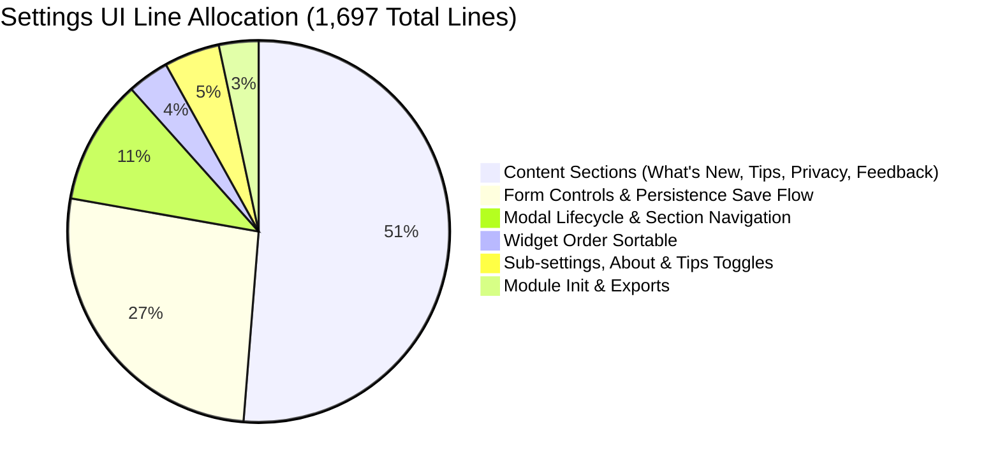
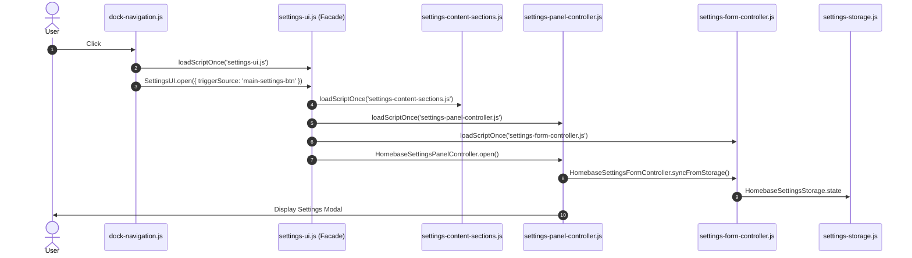

# Homebase Cycle #14 — Phase 3 Plan: Settings UI & Controller Modularization (`settings-ui.js`)

**Document:** `docs/cycles/cycle-14/phase-3-plan.md`  
**Date:** October 11, 2026  
**Status:** PROPOSED — AWAITING REVIEW & APPROVAL  
**Cycle Target:** Settings Panel Modularization  
**Phase Focus:** Deconstruct Lazy-Loaded Monolith `src/newtab/settings/settings-ui.js` into Focused Subsystems  
**Baseline Subsystem Size:** 1,697 lines, 65.6 KB in `src/newtab/settings/settings-ui.js`  
**Target Unit Test Status:** 370 / 370 passing (100%), 0 declaration collisions  

---

## 1. Executive Summary & Problem Statement

Following the completion of **Cycle #14 Phase 2** ([`docs/cycles/cycle-14/phase-2-completion-summary.md`](file:///c:/Users/Administrator/Desktop/Homebase/docs/cycles/cycle-14/phase-2-completion-summary.md)), the storage keys, default values, in-memory state model, and batch persistence logic are now canonically owned by [`src/newtab/settings/settings-storage.js`](file:///c:/Users/Administrator/Desktop/Homebase/src/newtab/settings/settings-storage.js).

However, the user interface layer remains encumbered by a single, monolithic procedural file:
$$\textbf{Current Monolith: } \texttt{src/newtab/settings/settings-ui.js} \quad (1,697\text{ lines}, 65.6\text{ KB})$$

### 1.1 Key Deficiencies in `settings-ui.js`
1. **Residual Duplicate Save Engine**: Despite Phase 2 centralizing persistence in `HomebaseSettingsStorage.save()`, `settings-ui.js` (lines 1458–1666) still retains an inline 208-line `saveBtn.addEventListener('click')` handler that manually queries 37 DOM IDs, builds a raw 28-key dictionary, and independently calls `HomebaseStorage.setMany(settingsBatch)`.
2. **Content Bloat**: Over 50% of `settings-ui.js` (~870 lines) is comprised of non-settings informational content and markdown renderers (What's New changelog parsing, Pro Tips setting-based filtering, Privacy Policy fetching, and Feedback issue reporting).
3. **Entangled Modal & Form Lifecycle**: Modal dialog presentation (backdrop blur, ESC key, focus trapping, tab navigation) is intertwined with form input scraping, live preview listeners, and SortableJS drag-and-drop operations.
4. **Maintenance Fragility**: Any change to a single setting input requires navigating a 1,700-line file with multiple overlapping closures and state holders.

Phase 3 deconstructs `settings-ui.js` into clean, cohesive modules while preserving its lazy-loaded architecture so dashboard initial paint remains sub-50ms.

---

## 2. Comprehensive Audit of `settings-ui.js`

### 2.1 File Metrics
- **Location**: `src/newtab/settings/settings-ui.js`
- **Total Lines**: 1,697 lines
- **Total Size**: 65,600 bytes
- **Loading Mode**: **Lazy On-Demand** (loaded via `loadScriptOnce('newtab/settings/settings-ui.js')` when the user clicks `#main-settings-btn` in `dock-navigation.js`).
- **Export Pattern**: `window.SettingsUI = { init, open, ensureFeedbackDiagnosticButton }`.

### 2.2 Responsibility Breakdown



| Subsystem / Responsibility | Line Range | Lines | Core Operations & Logic |
|---|---|---|---|
| **What's New Section** | Lines 27–352 | ~325 | Parses `CHANGELOG.md` markdown (`parseChangelogMarkdown`), manages version storage keys (`WHATS_NEW_STORAGE_KEY`), calculates unread badges (`updateWhatsNewNavBadge`), renders release cards (`renderWhatsNewSection`). |
| **Pro Tips Section** | Lines 354–585 | ~230 | Injects Pro Tips nav and section, reads setting state via `readSettingStateById`, filters `HOMEBASE_TIPS` based on active feature toggles (`getFilteredProTips`), renders accordion list with smooth expand/collapse. |
| **Section Navigation** | Lines 587–620 | ~35 | `setActiveAppSettingsSection(targetSection)`: switches tab classes, coordinates `PANELS_WITHOUT_ACTIONS` to show/hide footer Save/Cancel buttons. |
| **Diagnostics Integration** | Lines 622–700 | ~80 | `ensureDiagnosticUILoaded`: lazy-loads `diagnostic-ui.js` via `loadScriptOnce`, renders diagnostics section containers. |
| **Privacy Policy Section** | Lines 701–878 | ~180 | Injects Privacy nav item, fetches `PRIVACY.md` via `loadPrivacyPolicyInto`, parses markdown, handles external links. |
| **Feedback & Social Handler** | Lines 880–1012 | ~135 | Generates store review and issue tracker URLs, handles link copying with toast animation (`setFeedbackButtonTemporaryText`), manages social action buttons. |
| **Section Ordering** | Lines 1013–1074 | ~60 | `ensureSettingsSectionOrder`: rearranges navigation items into standard order. |
| **Widget Reorder Sortable** | Lines 1075–1135 | ~60 | Initializes SortableJS on `#widget-order-list`, updates widget order via `setWidgetOrderPreference` on drag drop (`commitWidgetOrder`). |
| **About & Sub-Settings** | Lines 1136–1190 | ~55 | Hydrates extension manifest version (`about-version`), handles `homebaseTipsDisabled` toggle. |
| **Modal Dialog Lifecycle** | Lines 1192–1217 | ~25 | `openAppSettingsModal`, `closeAppSettingsModal`, focus handling, backdrop transition. |
| **Form Scraping & Save Flow** | Lines 1218–1668 | ~450 | Queries 37 element handles, binds live preview events (dim slider, blur slider, opacity slider, animation speed), assembles raw `settingsBatch`, issues `HomebaseStorage.setMany`, refreshes wallpaper, closes modal. |
| **Facade & Exports** | Lines 1669–1697 | ~30 | `init()`, `open()`, and `ensureFeedbackDiagnosticButton()` exported on `window.SettingsUI`. |

### 2.3 DOM Elements & Selectors Owned
`settings-ui.js` interacts with 37 distinct element IDs in `#app-settings-modal`:
- **Modal Containers**: `app-settings-modal`, `app-settings-dialog`, `app-settings-nav`, `main-settings-btn`
- **Actions**: `app-settings-close`, `app-settings-cancel`, `app-settings-save`
- **General / Appearance Controls**: `app-time-format`, `app-dim-slider`, `app-dim-value-label`, `app-show-sidebar-toggle`, `app-performance-mode-toggle`, `app-perf-debug-overlay-toggle`, `app-battery-optimization-toggle`, `app-cinema-mode-toggle`, `app-singleton-mode-toggle`
- **Bookmarks Controls**: `app-bookmark-open-new-tab-toggle`, `app-bookmark-text-bg-toggle`, `app-bookmark-text-bg-color-trigger`, `app-bookmark-text-opacity-slider`, `app-bookmark-text-blur-slider`, `app-bookmark-fallback-color-trigger`, `app-bookmark-folder-color-trigger`
- **Search Controls**: `app-search-open-new-tab-toggle`, `app-search-remember-engine-toggle`, `app-search-math-toggle`, `app-search-history-toggle`, `app-search-suggestions-toggle`, `app-search-default-engine-select`
- **Container Controls**: `app-container-mode-toggle`, container behavior radios
- **Gallery / Wallpaper Controls**: `app-daily-toggle`, `app-wallpaper-type-select`, `app-wallpaper-quality-select`, `gallery-settings-preview-video`
- **Animation Controls**: `app-grid-animation-toggle`, `app-grid-animation-speed-slider`, `grid-animation-sub-settings`
- **Content Sections**: `whats-new-list`, `whats-new-date`, `whats-new-version`, `whats-new-nav-badge`, `pro-tips-list`, `about-version`

### 2.4 External Dependencies
- **`HomebaseSettingsStorage`**: Canonic source of truth for `keys`, `defaults`, `state`, and `save()`. Currently bypassed by legacy inline save!
- **`HomebaseSettingsPreferences`**: Provides `sync()` and `handleStorageChange()`.
- **`HomebaseStorage`**: Currently called directly for `setMany()`, `remove('currentSearchEngineId')`, and `set(WALLPAPER_SELECTION_KEY)`.
- **`HomebaseWallpaperController`**: `ensureDailyWallpaper(false)`, `applyWallpaperByType()`, `rebuildCurrentSelectionFromGallery()`.
- **`HomebaseSearchEngineSettings`**: `updateSearchUI()`, `updateDefaultEngineVisibilityControl()`.
- **`HomebaseDialogController`**: Modal presentation animation utilities.
- **`initUnifiedSortable`**: Vendor SortableJS wrapper for widget order list.

---

## 3. Repository Usage & Consumer Map

A search across the repository reveals all references to settings UI symbols:

```text
1. dock-navigation.js:
   • Lines 57–63:
     await loadScriptOnce('newtab/settings/settings-ui.js');
     if (window.SettingsUI && typeof window.SettingsUI.open === 'function') {
       await window.SettingsUI.open({ triggerSource: 'main-settings-btn' });
     }

2. tests/unit/settings-storage.test.mjs:
   • Evaluates settingsUiScriptCode in VM sandbox.
   • Tests background dim slider persistence and saveSettings batch write.

3. tests/unit/diagnostic-ui.test.mjs:
   • References settings-ui.js path for diagnostic integration.

4. scripts/check-newtab-static.mjs:
   • Lists "newtab/settings/settings-ui.js" in keyExtractedModulePaths.
   • Verifies no stale references to flat "settings-ui.js".

5. AGENTS.md:
   • Rule 4.3: "src/settings-ui.js and src/gallery-ui.js must remain lazy-loaded on demand."
```

**Key Takeaways**:
- The ONLY external caller of `settings-ui.js` is `src/newtab/core/dock-navigation.js` via `window.SettingsUI.open()`.
- `settings-ui.js` is **NOT** included in `src/new-tab.html` as a deferred script; it is loaded dynamically on user click.
- `window.SettingsUI` public contract (`init()`, `open()`, `ensureFeedbackDiagnosticButton()`) must remain 100% stable.

---

## 4. Proposed Target Architecture & Module Boundaries

To achieve clean separation of concerns while preserving the lazy-loaded architecture, `settings-ui.js` will be deconstructed into four cohesive modules located in `src/newtab/settings/`:

```text
src/newtab/settings/
├── settings-storage.js              # [CANONICAL ENGINE] Storage keys, defaults, state, persistence (Phase 2)
├── settings-preferences.js          # [ADAPTER] DOM element references & live multi-tab change listener
├── sub-settings-ui.js               # [ANIMATIONS] Accordion transitions & expanders
├── search-engine-settings.js        # [MODAL] Search engines management modal
├── backup-import.js                 # [TRANSACTIONS] Export / Import backup engine
│
├── [EXTRACTED IN PHASE 3]:
├── settings-content-sections.js     # [NEW] What's New, Pro Tips, Privacy, Feedback renderers (~850 lines)
├── settings-panel-controller.js     # [NEW] Modal lifecycle, ESC/focus trap, tab routing, ordering (~200 lines)
├── settings-form-controller.js      # [NEW] DOM form harvesting, live sliders & unified save delegation (~350 lines)
└── settings-ui.js                   # [REFACTORED FACADE] Lazy loader & orchestrator (~120 lines)
```

### 4.1 Detailed Module Specifications

#### Module 1: `src/newtab/settings/settings-content-sections.js`
- **Scope**: All non-form informational content panels.
- **Responsibilities**:
  - `renderWhatsNewSection()`: parses changelog markdown, evaluates badge status, caches release entries.
  - `renderProTipsSection()`: dynamically filters `HOMEBASE_TIPS` against active `HomebaseSettingsStorage.state` properties; renders accordion.
  - `renderPrivacySection()`: fetches and displays `PRIVACY.md`.
  - `handleFeedbackAction()`: manages issue tracker, feature request, and store review URLs.
  - `ensureFeedbackDiagnosticButton()`: binds diagnostic modal launch button.
- **Public Export**: `window.HomebaseSettingsContentSections`
- **Estimated Size**: ~850 lines

#### Module 2: `src/newtab/settings/settings-panel-controller.js`
- **Scope**: Modal dialog presentation and navigation routing.
- **Responsibilities**:
  - `openModal(triggerSource)`: manages overlay visibility, transitions, aria attributes, focus management.
  - `closeModal()`: hides dialog, restores trigger focus, resets uncommitted state.
  - `setupKeyboardAndOverlayListeners()`: ESC key handler, backdrop overlay click handler.
  - `setActiveSection(sectionName)`: tab switching, active class toggling, coordinates `PANELS_WITHOUT_ACTIONS` to hide Save/Cancel buttons on informational panels.
  - `ensureSectionOrder()`: enforces standard sidebar item sequence.
  - `setupWidgetOrderSortable()`: manages drag-and-drop widget arrangement in settings.
- **Public Export**: `window.HomebaseSettingsPanelController`
- **Estimated Size**: ~220 lines

#### Module 3: `src/newtab/settings/settings-form-controller.js`
- **Scope**: Form control bindings, live previews, and unified save pipeline.
- **Responsibilities**:
  - `setupFormControls()`: binds live input listeners (dim slider, text blur/opacity sliders, speed slider, animation toggles, color triggers).
  - `harvestFormData()`: scrapes all form control values and produces a normalized update payload.
  - `saveFormSettings()`: **Delegates directly to `HomebaseSettingsStorage.save(updates)`!**
    - Eliminates the duplicate 30-key `settingsBatch` assembly.
    - Eliminates direct `HomebaseStorage.setMany()` from UI code.
    - Triggers wallpaper refresh (`ensureDailyWallpaper(false)`) and search engine cache cleanup (`currentSearchEngineId`) through clean service hooks.
- **Public Export**: `window.HomebaseSettingsFormController`
- **Estimated Size**: ~320 lines

#### Module 4: `src/newtab/settings/settings-ui.js` (Refactored Facade)
- **Scope**: Top-level lazy-load coordinator and public API facade.
- **Responsibilities**:
  - When `dock-navigation.js` loads `settings-ui.js` and calls `SettingsUI.open()`:
    - Coordinates loading helper modules (`settings-content-sections.js`, `settings-panel-controller.js`, `settings-form-controller.js`) via `loadScriptOnce`.
    - Initializes subsystems in proper dependency order.
    - Delegates `open()` to `HomebaseSettingsPanelController.open()`.
    - Preserves exact `window.SettingsUI` interface.
- **Public Export**: `window.SettingsUI = { init, open, ensureFeedbackDiagnosticButton }`
- **Estimated Size**: ~120 lines

---

## 5. Script Loading & Runtime Architecture

### 5.1 Preservation of Lazy-Loading Invariant
Per **AGENTS.md Rule 4.3**: `settings-ui.js` must remain lazy-loaded on demand.

To ensure new-tab dashboard startup paint remains <50ms, the newly extracted modules will **NOT** be added to `src/new-tab.html` as startup deferred scripts. Instead, they will be loaded dynamically on-demand when the user clicks the Settings button:

```javascript
// Inside src/newtab/settings/settings-ui.js
async function ensureSettingsSubsystemsLoaded() {
  if (subsystemsLoaded) return;
  await Promise.all([
    loadScriptOnce('newtab/settings/settings-content-sections.js'),
    loadScriptOnce('newtab/settings/settings-panel-controller.js'),
    loadScriptOnce('newtab/settings/settings-form-controller.js')
  ]);
  subsystemsLoaded = true;
}
```

### 5.2 Loading Order Flow



---

## 6. Migration Sequence & Phased Execution

To maintain stability and zero-breakage guarantees throughout Cycle #14 Phase 3, implementation is broken down into 4 clear steps:

```text
Phase 3A: Extract Content Sections
  • Create src/newtab/settings/settings-content-sections.js (What's New, Pro Tips, Privacy, Feedback)
  • Verify syntax and lazy-loading
  • Checkpoint verification (check-newtab-static.mjs, npm test)

Phase 3B: Extract Panel Controller & Widget Sortable
  • Create src/newtab/settings/settings-panel-controller.js (Dialog lifecycle, ESC/focus trap, tab routing, widget sortable)
  • Verify modal transitions and focus restoration
  • Checkpoint verification

Phase 3C: Extract Form Controller & Unify Save Flow
  • Create src/newtab/settings/settings-form-controller.js
  • Replace duplicate save in settings-ui.js with HomebaseSettingsStorage.save(updates)
  • Refactor settings-ui.js into a clean orchestrator facade (~120 lines)
  • Checkpoint verification

Phase 3D: Test Harmonization, Static Scanners & Stabilization
  • Update tests/unit/settings-storage.test.mjs to test extracted controllers
  • Update scripts/check-newtab-static.mjs keyExtractedModulePaths
  • Run full verification suite (unit tests, static scan, browser smoke, dual build)
  • Author Phase 3 completion report
```

---

## 7. Risk Analysis & Mitigation Strategies

| Risk | Severity | Failure Mode | Mitigation Strategy |
|---|---|---|---|
| **Lazy Script Loading Race** | **HIGH** | User opens settings modal before one of the parallel sub-scripts finishes loading. | `settings-ui.js` uses `await Promise.all([loadScriptOnce(...)])` ensuring all sub-controllers are fully evaluated before invoking `open()`. |
| **Form Scraping Regressions** | **HIGH** | An obscure form input (e.g. text opacity slider or container radio) is missed in `harvestFormData()`, causing setting loss on save. | Extract form harvesting directly from the working 200-line scraper in `settings-ui.js`. Cross-check all 30 keys in `settingsBatch`. Add unit test asserting all keys roundtrip. |
| **Duplicate Save Discrepancy** | **MEDIUM** | `settings-ui.js` performed special side effects (e.g. `rebuildCurrentSelectionFromGallery`, `ensureDailyWallpaper`) that `settings-storage.js` doesn't handle. | Audit all side effects in `settings-ui.js` lines 1627–1664 and ensure `HomebaseSettingsFormController.saveFormSettings()` triggers them cleanly after `HomebaseSettingsStorage.save()`. |
| **Static Checker Collision** | **MEDIUM** | Helper functions in extracted files share top-level identifiers with existing deferred scripts. | Encapsulate all extracted files in IIFEs (`window.HomebaseSettings* = (() => { ... })()`). Zero top-level `const`/`let` declarations in global scope. |
| **SortableJS Timing Failure** | **LOW** | `#widget-order-list` Sortable initialization runs before DOM elements exist. | Retain Sortable setup inside `HomebaseSettingsPanelController.open()` when DOM nodes are guaranteed present. |

---

## 8. Verification Plan

Each sub-phase will execute the mandatory verification toolchain before proceeding:

1. **Syntax Validation**:
   ```powershell
   node --check src/newtab/settings/settings-content-sections.js
   node --check src/newtab/settings/settings-panel-controller.js
   node --check src/newtab/settings/settings-form-controller.js
   node --check src/newtab/settings/settings-ui.js
   ```
2. **Static Invariants & Collision Scan**:
   ```powershell
   node scripts/check-newtab-static.mjs
   ```
   - Must verify 0 top-level declaration collisions.
   - Must verify all extracted module paths in `keyExtractedModulePaths`.
3. **Automated Test Suite**:
   ```powershell
   npm.cmd test
   ```
   - Stage 1: Syntax Validation PASS
   - Stage 2: Static Invariants PASS
   - Stage 3: Unit Tests 370/370 PASS
   - Stage 4: Headless Browser Smoke Test PASS
4. **Dual Browser Build**:
   ```powershell
   npm.cmd run build
   ```
   - Must produce clean distributions in `dist/chrome/` and `dist/firefox/`.
5. **Protected Files Invariant**:
   ```powershell
   git diff src/preload.js src/instant_load.js manifests/ dist/
   ```
   - Must return 0 diffs.

---

## 9. Rollback Strategy

Because `settings-ui.js` is backed up in git commit `57a41d5`, rollback at any point during Phase 3 is trivial:
- If sub-phase extraction encounters unexpected browser-specific issues, git can restore `src/newtab/settings/settings-ui.js` cleanly with:
  ```powershell
  git checkout HEAD -- src/newtab/settings/settings-ui.js
  ```
- Any newly created module files can simply be removed without impacting existing deferred scripts or startup runtime.
