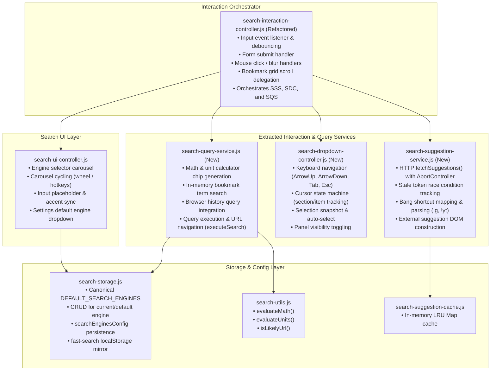

# Cycle #15: Search Subsystem Modularization Plan

**Cycle**: #15 — Search Subsystem Modularization & Decoupling  
**Phase**: Phase 1 — Implementation Roadmap & Architectural Plan  
**Status**: Draft (Awaiting Approval)  
**Date**: 2026-10-11  

---

## 1. Objectives & Architectural Vision

The primary goal of Cycle #15 is to decompose the monolithic [`src/newtab/search/search-interaction-controller.js`](file:///c:/Users/Administrator/Desktop/Homebase/src/newtab/search/search-interaction-controller.js) (currently 1,976 lines) and harmonize search configuration storage across the repository.

### Core Principles
1. **Single Responsibility per Controller**: Decouple dropdown navigation, external HTTP suggestion fetching, query resolution (math, history, bookmarks), and user event binding into focused, maintainable services.
2. **Authoritative Storage & Schema Harmonization**: Resolve mismatched search preference keys between `search-ui-controller.js` and `search-storage.js`, and eliminate direct storage writes in `search-engine-settings.js` in favor of canonical delegation to `HomebaseSearchStorage`.
3. **100% Backward Compatibility**: Preserve all existing public APIs (`window.HomebaseSearch*`, global helper aliases, all existing 44 unit tests, and the Edge browser smoke test).
4. **Zero Startup Degradation**: Maintain instant new-tab load performance with clean script dependency ordering in `src/new-tab.html`.

---

## 2. Target Architecture & Module Boundaries



---

## 3. Phased Implementation Roadmap

### Phase 2: Search Storage Schema Harmonization & Encapsulation
- **Goal**: Clean up storage keys and persistence boundaries before UI modularization.
- **Tasks**:
  1. Fix key mismatches in `search-ui-controller.js` (`SEARCH_ENGINES_PREF_KEY = 'searchEnginesConfig'`, `APP_SEARCH_DEFAULT_ENGINE_KEY = 'appSearchDefaultEngine'`, `APP_SEARCH_REMEMBER_ENGINE_KEY = 'appSearchRememberEngine'`).
  2. Refactor `src/newtab/settings/search-engine-settings.js` to delegate persistence to `HomebaseSearchStorage.setSearchEnginesConfig()` and `HomebaseSearchStorage.setDefaultSearchEngineId()`.
  3. Wrap `search-storage.js` in IIFE isolation while preserving all `window` exports and top-level compatibility constants.
  4. Add unit test validations.

### Phase 3: Extraction of External Suggestion & Bang Service (`search-suggestion-service.js`)
- **Goal**: Extract network requests, debounce tokens, abort controllers, and bang mapping.
- **Tasks**:
  1. Create `src/newtab/search/search-suggestion-service.js` (~350 lines).
  2. Move `fetchSuggestions()`, `abortSuggestionFetch()`, `isStaleSearch()`, `getBangMap()`, `getBangSuggestions()`, and suggestion HTML rendering.
  3. Connect to `search-suggestion-cache.js`.
  4. Register on `window.HomebaseSearchSuggestionService`.
  5. Add dedicated unit tests.

### Phase 4: Extraction of Search Dropdown Navigation Controller (`search-dropdown-controller.js`)
- **Goal**: Extract keyboard cursor navigation, selection state machine, and panel visibility.
- **Tasks**:
  1. Create `src/newtab/search/search-dropdown-controller.js` (~450 lines).
  2. Move `selectItem()`, `clearAllSelections()`, `moveSection()`, `getSelectionSnapshot()`, `applySelectionToCurrentResults()`, `handleKeydown()`, and `updatePanelVisibility()`.
  3. Register on `window.HomebaseSearchDropdownController`.
  4. Add dedicated unit tests.

### Phase 5: Extraction of Search Query & Execution Service (`search-query-service.js`)
- **Goal**: Extract query routing, math chip generation, bookmark search, and history search.
- **Tasks**:
  1. Create `src/newtab/search/search-query-service.js` (~450 lines).
  2. Move `executeSearch()`, calculator chip DOM building, in-memory bookmark search filtering, browser history search query, and favicon hydration.
  3. Register on `window.HomebaseSearchQueryService`.
  4. Add dedicated unit tests.

### Phase 6: Orchestrator Slimdown & Subsystem Stabilization
- **Goal**: Reduce `search-interaction-controller.js` to a clean ~300-line event orchestrator, verify static invariants, and update documentation.
- **Tasks**:
  1. Slim down `search-interaction-controller.js` to pure DOM event wiring and lifecycle coordination.
  2. Update `src/new-tab.html` script loading tags.
  3. Update `scripts/check-newtab-static.mjs` key extracted module paths.
  4. Execute full verification suite (`node --check`, static scanner, test suite, dual build).
  5. Author Cycle #15 completion summary.

---

## 4. Script Loading & Static Checking Rules

### 4.1 Script Tag Sequence in `src/new-tab.html`
Scripts must load in exact topological order:
```html
<script src="newtab/search/search-storage.js" defer></script>
<script src="newtab/search/search-utils.js" defer></script>
<script src="newtab/search/search-suggestion-cache.js" defer></script>
<script src="newtab/search/search-suggestion-service.js" defer></script>
<script src="newtab/search/search-dropdown-controller.js" defer></script>
<script src="newtab/search/search-query-service.js" defer></script>
<script src="newtab/search/search-ui-controller.js" defer></script>
<script src="newtab/search/search-interaction-controller.js" defer></script>
```

### 4.2 Static Invariant Checks
- Add all new module paths to `keyExtractedModulePaths` in `scripts/check-newtab-static.mjs`.
- Zero top-level `const`/`let` declaration collisions across all deferred scripts.

---

## 5. Backward Compatibility & Verification Matrix

- **Unit Tests**: All 44 existing search unit tests in `tests/unit/search-*.test.mjs` must remain green at all stages.
- **Browser Smoke Test**: Headless Edge smoke test must verify search bar rendering and event response.
- **Public Window APIs**: Every window export must remain functional:
  - `window.HomebaseSearchInteractionController`
  - `window.HomebaseSearchUiController`
  - `window.HomebaseSearchStorage`
  - `window.setupSearch`
  - `window.updateSearchUI`
  - `window.clearSearchUI`
  - `window.hideSearchResultsPanel`
  - `window.cycleSearchEngine`
  - `window.executeSearch`

---

## 6. Commit & Rollback Boundaries

Each phase (2, 3, 4, 5, 6) will execute strictly within the 7-step development lifecycle:
1. Audit
2. Plan
3. Wait for User Approval
4. Implement
5. Verify
6. Commit
7. Push

No code changes will be committed without explicit user review and approval at each boundary.
