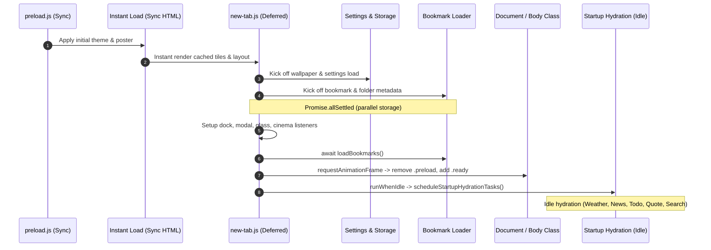

# Cycle #21 Phase 1 — Startup Pipeline & Runtime Resilience Audit

## 1. Executive Summary

Cycle #21 focuses on hardening the startup sequence, isolating subsystem errors with a dedicated runtime error boundary (`HomebaseRuntimeGuard`), and providing structured observability and diagnostics across all lifecycle stages.

Following Cycle #20's successful widget controller consolidation, all 5 widgets now have canonical controllers (`HomebaseWidget*`). However, an audit of the startup sequence in `src/new-tab.js` and `src/newtab/core/startup-hydration.js` reveals areas where uncaught errors could stall dashboard initialization or leave the page in an unready state.

---

## 2. Startup Pipeline Architecture

### 2.1 Current Startup Sequence (`src/new-tab.js`)

### 2.2 Critical Phase vs. Idle Hydration Phase

The startup sequence is strictly split into two phases:
1. **Critical Phase** (`STARTUP_PHASE = 'critical'`):
   - Fast parallel storage resolution (`settings`, `bookmarkMetadata`, `lastUsedFolderId`, `wallpaperType`).
   - Clock initialization (`HomebaseWidgetTime.initialize()`).
   - Primary bookmark tree load (`HomebaseBookmarkLoader.loadBookmarks()`).
   - Ready state flip (`body.classList.remove('preload')`, `body.classList.add('ready')`).
2. **Idle Hydration Phase** (`STARTUP_PHASE = 'ready'`):
   - Scheduled via `runWhenIdle` and cooperative `requestIdleCallback` (fallback 16ms setTimeout).
   - Tasks:
     1. `startup:loadCachedWeather`
     2. `startup:quoteIndex`
     3. `startup:setupQuoteWidget`
     4. `startup:setupNewsWidget`
     5. `startup:setupTodoWidget`
     6. `startup:setupSearch`
     7. `startup:setupWeather`
     8. `startup:setupAppLauncher`
     9. `startup:fetchQuote`
     10. `startup:ensureDailyWallpaper`

---

## 3. Vulnerability & Failure Isolation Audit

### 3.1 Unprotected Critical Initialization Blocks in `new-tab.js`
In `src/new-tab.js`:
- Lines 102–104 (`await window.HomebaseBookmarkLoader.loadFolderMetadata()`): Not wrapped in an error boundary. If folder metadata fails, the rest of `initializePage` halts.
- Lines 107–156 (`setupCinemaModeListeners`, `setupContainerMode`, `setupDockNavigation`, `setupAnimationSettings`, `setupGlassSettings`, `setupMaterialColorPicker`, `setupSearchEnginesModal`, `setupQuickActions`, `setupFolderPickerModal`): Any missing DOM node or uncaught TypeError stops execution before `loadBookmarks()` and before `markPageReadyOnce()`. As a result, the page remains stuck in `.preload` indefinitely.
- Lines 234–272 (Context menu, dialog, grid click delegation, and drag controllers): If context menu setup throws, subsequent controllers (grid click, drag) are abandoned.

### 3.2 Error Containment in `startup-hydration.js`
In `src/newtab/core/startup-hydration.js`:
- Each task wraps its body in a localized `try/catch` and outputs `console.warn`.
- **Gaps**:
  1. No structured error aggregation: Errors are logged to console but not retained in memory for diagnostic retrieval or telemetry.
  2. No unified classification: Failures do not distinguish between network offline errors, parsing errors, missing DOM elements, or critical system faults.
  3. No fallback mechanism: When a task fails, there is no standard way to provide fallback state.

### 3.3 Error Containment in `widget-lifecycle.js`
In `src/newtab/widgets/widget-lifecycle.js`:
- `safeInvoke(fn, callbackName, widgetId)` catches errors and logs `console.warn`.
- `initializeAll()` catches errors per widget and continues.
- `destroyAll()` catches errors per widget and continues.
- **Gaps**:
  1. Swallowed errors are invisible to debugging tools and test assertions.
  2. Dynamic widget registration or unregistration doesn't report to a centralized guard.

---

## 4. Performance & Metrics Audit

### 4.1 Existing Performance Instrumentation
- `perf-report.js` & `startup-perf-runtime.js`:
  - Marks: `script-start`, `newtab:init-start`, `parallel-start`, `parallel-done`, `ready-class`, `after-ready-paint`.
  - Measures: `parallel-storage-loads`, `script-to-ready-class`, `init-to-ready-class`, `script-to-after-ready-paint`.
  - Task timing: `recordWidgetPerfTiming(name, elapsedMs)`.

### 4.2 Missing Metrics & Observability
1. **Total Startup Pipeline Health**: Count of successfully settled tasks vs. failed tasks.
2. **Error Boundary Diagnostics**: A queryable buffer of captured errors with timestamps, context labels, and component tags.
3. **Execution Latency per Phase**: Microsecond/millisecond breakdown of critical phase versus idle hydration phase.

---

## 5. Architectural Blueprint for Phase 3: `HomebaseRuntimeGuard`

To resolve the above vulnerabilities, we introduce `HomebaseRuntimeGuard` (`src/newtab/core/runtime-guard.js`):

### 5.1 Responsibilities
1. **Safe Function Execution**: Wrap synchronous (`wrap`, `run`) and asynchronous (`wrapAsync`, `runAsync`) functions with automatic error containment.
2. **Structured Error Logging**: Capture errors with normalized payloads:
   - `error`: Error instance (message, stack, name)
   - `context`: String identifier (e.g., `'startup:setupWeather'`, `'widget:time:init'`, `'critical:dockNavigation'`)
   - `subsystem`: Categorized domain (`'startup'`, `'widget'`, `'storage'`, `'bookmarks'`, `'settings'`)
   - `severity`: Level (`'critical'`, `'warning'`, `'info'`)
   - `timestamp`: Epoch millisecond
   - `handled`: Boolean
3. **Fallback Provision**: Return a provided fallback value if execution throws.
4. **Diagnostic Retrieval & Clearing**: Provide `getDiagnostics()`, `hasErrors()`, `clearDiagnostics()`.
5. **Event Emission**: Allow observers (e.g. diagnostics UI or test suites) to subscribe via `addListener(listener)`.

---

## 6. Implementation Strategy

1. **Phase 2**: Conduct runtime profiling across DOM queries, event listeners, intervals, and storage access; compile `docs/cycles/cycle-21/performance-report.md`.
2. **Phase 3**:
   - Implement `src/newtab/core/runtime-guard.js`.
   - Register in `src/new-tab.html` as early deferred core script.
   - Guard critical steps in `src/new-tab.js`.
   - Guard idle tasks in `src/newtab/core/startup-hydration.js`.
   - Connect `safeInvoke` in `src/newtab/widgets/widget-lifecycle.js` to `HomebaseRuntimeGuard`.
3. **Phase 4**:
   - Create comprehensive unit test suite in `tests/unit/runtime-guard.test.mjs`.
   - Update `scripts/check-newtab-static.mjs` to enforce `HomebaseRuntimeGuard`.
   - Run complete verification suite and commit.
